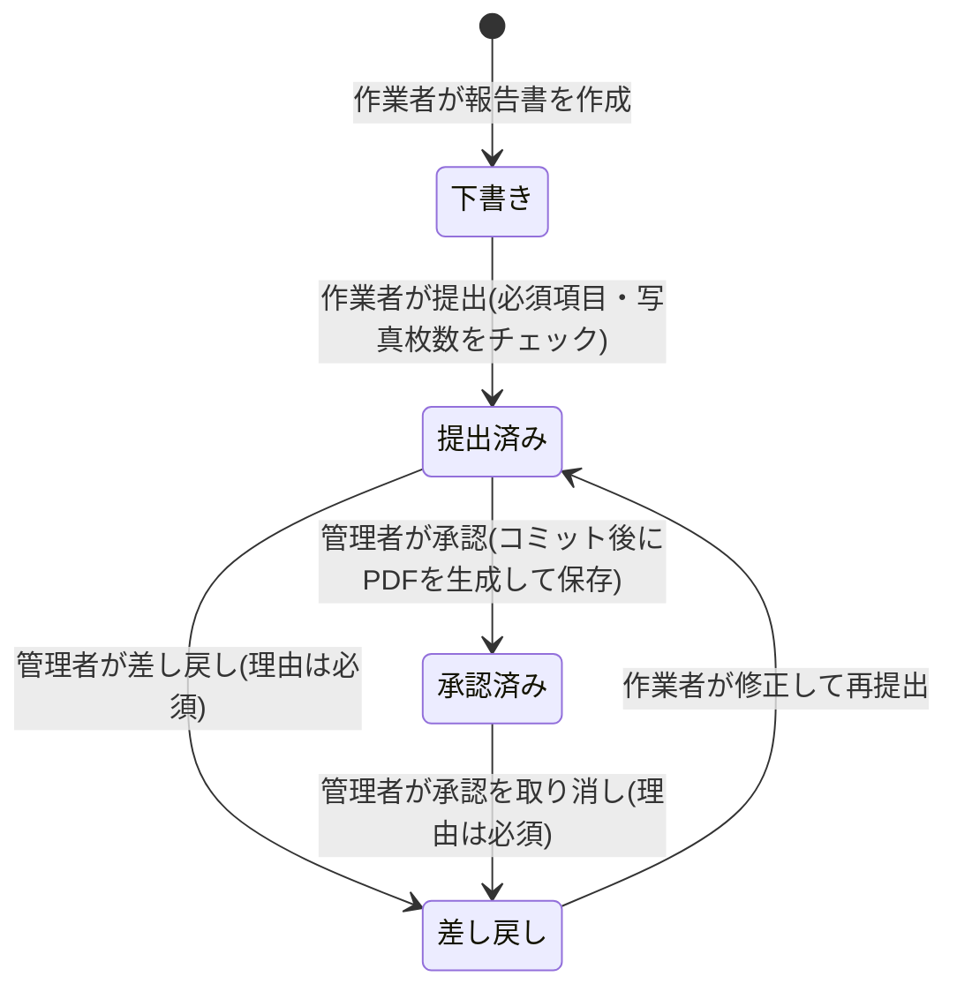
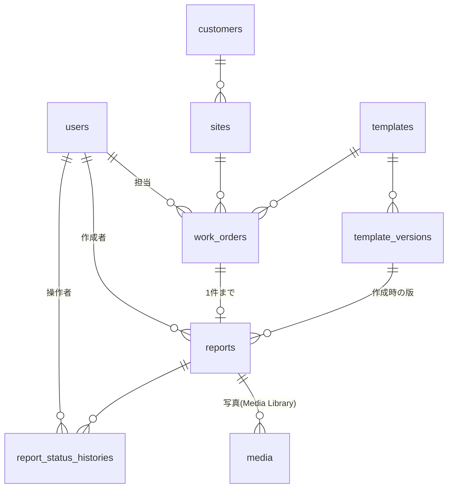
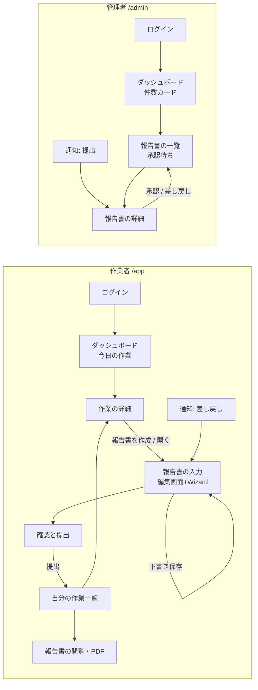

# 作業報告書作成ツール 設計書

2026-10-11 時点の設計。YouTrack のナレッジ(POR-A-2)から移したもので、以後はこのファイルを正とする。仕様を変えたら、このファイルも同じプルリクエストで更新する。

## 1. 概要と位置づけ

- 清掃・点検・退去立会いなど、業種を問わず使える作業報告書作成アプリ
- 共通の項目部品を組み合わせたテンプレート(JSON)を差し替えるだけで業種に対応する「土台」を作る
- 顧客ごとの書式は、テンプレートとPDF書式を追加して対応する「セミオーダー型の受託」を想定する

## 2. 基本方針

- Filament をフル活用して作る。合わない部分が見つかったら後で修正する
- 機能は最小限(入力 → 承認 → PDF の1本の流れ+テンプレート2種類)
- 業務ロジックは画面から切り離して Service クラスに置く(作業者用の画面だけ後から別の技術に差し替えられるようにする)

## 3. 技術構成

| 項目 | 決定内容 |
| --- | --- |
| フレームワーク | Laravel 13 |
| 画面 | Filament v5(**5.6.5以上を指定**。CVE-2026-48500:ログイン前に一時ファイルをアップロードできる脆弱性が 5.6.4 以前にある) |
| 管理画面(パネル) | 2つ:/admin(管理者)、/app(作業者)。どちらも login() と profile()(パスワードの欄だけに差し替え)のみ有効 |
| 権限 | 入場は canAccessPanel()、報告書ごとの操作は Laravel の Policy |
| PDF | mPDF(mpdf/mpdf を直接使い、Service クラスで包む)+日本語フォント。問題が出た場合だけ Dompdf を試す(10-10) |
| 写真 | spatie/laravel-medialibrary + Filament公式プラグイン(SpatieMediaLibraryFileUpload)。詳細は 10-6 |
| 署名 | 入力は saade/filament-autograph。保存は画像ファイルに変換して Media Library の signatures コレクションへ(10-10) |
| 通知 | Filament のデータベース通知(画面内)。キュー経由で送られるため、キューワーカーの常駐が必要 |
| DB | MariaDB 12.3 LTS |
| PHP | 8.5 |

### バージョン(2026-10-11 確認)

| ソフトウェア | 採用 | サポート・最新版 |
| --- | --- | --- |
| PHP | 8.5 | セキュリティ修正は 2029-12-31 まで |
| Laravel | 13 | PHP 8.3〜8.5 対応。セキュリティ修正は 2028-03-17 まで(Laravel 14 は 2027年Q1 の見込み) |
| Filament | ^5.6.5 | 最新 v5.10.1(2026-10-07) |
| Livewire | 4 | 最新 v4.4.7 |
| MariaDB | 12.3 LTS | 2026-05-29 リリース、2029年6月まで保守 |
| Ubuntu(サーバー) | 26.04 LTS | 標準パッケージは PHP 8.5・MariaDB 11.8 |
| Pest | 5 | 最新 v5.3.1(PHP ^8.4 が必須) |
| Larastan | 3 | 最新 v3.13.0 |
| Pint | 1 | 最新 v1.32.1 |
| Laravel Boost | 2 | 最新 v2.10.3 |
| spatie/laravel-medialibrary | 11 | 11.23 系 |
| mpdf/mpdf | 8 | v8.3.1(PHP 8.5 まで明記) |
| saade/filament-autograph | 4 | 最新 v4.3.2 |
| laravel-lang/common | 6 | 6.8.0 |

## 4. 開発環境

- PHP:Laravel Herd(無料版)。`herd isolate 8.5` で本番予定の PHP 8.5 に固定
- DB:Docker(compose)で MariaDB 12.3 LTS。ローカルと本番でバージョンを揃える(Ubuntu 26.04 の標準パッケージは 11.8 なので、VPS では MariaDB 公式のリポジトリから入れる)
- 接続:`DB_CONNECTION=mariadb`、`DB_HOST=127.0.0.1`(localhost にしない)、ポートは 127.0.0.1:3306 に限定して公開
- データは Docker のボリュームに保存
- テストも SQLite ではなく MariaDB のテスト用データベースで実行(JSON 列の挙動の違いをテスト段階で見つけるため)
- Herd Pro は不要(DB は Docker に任せる)

```yaml
# compose.yaml
services:
  mariadb:
    image: mariadb:12.3
    ports:
      - "127.0.0.1:3306:3306"
    environment:
      MARIADB_ROOT_PASSWORD: password
      MARIADB_DATABASE: work_report
    volumes:
      - mariadb-data:/var/lib/mysql
volumes:
  mariadb-data:
```

注意:

- MariaDB の JSON 型は、中身は LONGTEXT に「正しい JSON か」のチェックを付けたもの。MySQL とは挙動に差が出ることがある
- MariaDB 12.3 LTS は 2029年6月まで保守される
- Docker Desktop は、従業員250人未満かつ年間売上1,000万ドル未満の会社・個人利用なら無料

## 5. MVP(入れるもの)

### 認証・権限

- メール+パスワードでのログイン。自分で登録する画面はなし
- 管理者がユーザーを作成し、初期パスワードを発行・再設定する(メールでのパスワード再設定はなし)
- 利用者が自分でパスワードを変更できる(プロフィール画面をパスワードの欄だけに差し替え。OWASP ASVS 4.0 の 2.1.5 がレベル1の要件、2.1.6 で現在のパスワードの入力も要件)
- ログイン試行回数の制限(標準機能)
- 役割は作業者/管理者の2つ(users テーブルに役割の列)。spatie/laravel-permission などは使わない
- 退職者は削除せず無効化(過去の報告書の作業者・承認者を残す)

### 報告書

- 作業者:自分の作業一覧 → 入力 → 下書き保存 → 提出
- 管理者:承認・差し戻し(差し戻し理由を入力、履歴を残す)
- 承認済みの報告書を PDF 出力
- 画面内通知(提出・承認・差し戻し・承認取り消し)

### テンプレート

- 項目の種類:テキスト、選択、3値チェック(問題なし/問題あり/対象外)、写真(枚数指定)、前後の写真ペア、署名
- 項目ごとの必須・必要な写真枚数(撮り忘れ防止。提出前にチェック)
- 版管理(報告書は作成時のテンプレートの版を持つ。テンプレートを直しても過去の報告書が崩れない)
- テンプレートは開発者が JSON で定義(画面で作る機能は作らない)
- デモ用:①ハウスクリーニング(前後の写真ペア中心) ②退去立会い(3値チェック+署名中心)

### 管理

- ユーザー、顧客・現場、作業、報告書の一覧・検索・絞り込み(状態・現場・期間・作業者)
- 承認待ちの件数をメニュー横のバッジで表示

### データ

- 共通項目(作業日・現場・作業者・状態)は普通の列、業種ごとの回答は JSON 列
- 報告書は「作業」にぶら下げる
- 写真の登録日時(サーバーが受け取った時刻)と SHA-256 ハッシュ値、提出日時を保存(10-6)

### テスト

- 権限:他人の報告書は拒否/提出済みは作業者が編集不可/作業者は承認不可/無効化したユーザーはログイン不可
- 状態の移り変わり(下書き → 提出 → 承認/差し戻し)

## 6. Filament に任せる部分と自作する部分

| Filament に任せる | 自作する |
| --- | --- |
| ログイン、Resource(一覧・作成・編集)、テーブルの絞り込み、ToggleButtons、SpatieMediaLibraryFileUpload(ブラウザ側で画像縮小、付加情報、縮小版。10-6 参照)、Wizard、Action(提出・承認・差し戻し)、enum のラベル・色、データベース通知、Infolist、テスト補助、databaseTransactions() | テンプレート JSON → Filament フォーム部品への変換、状態の移り変わりと履歴、PDF 出力、テンプレートの版管理、Policy、権限・状態のテスト |

## 7. スマホ対応(Filament 公式デモで検証・2026-10-11)

- 問題なし:メニューの引き出し、Wizard(スマホでは今のステップだけ表示)、ToggleButtons の折り返し
- 作業者の一覧はすべて `stackedOnMobile()`(標準のままだと横スクロールになり、状態の列が画面外に出る)
- 入力はテンプレートのセクションごとにステップを分け、1画面を短くする(「次へ」が一番下にあるため)
- ToggleButtons は `size()` で大きくする(標準のボタンは実測 32〜36px)
- FileUpload の案内文を「写真を撮る・選ぶ」に変える
- RichEditor は作業者の入力に使わない
- filament-mobile-preset プラグインは参考に留める(2026年7月作成で実績が見えないため)
- 実機確認が必要(iPhone・Android):カメラ起動、写真の形式、署名の書き心地、タッチ操作、絞り込み表示

## 8. スコープ

### 今後(MVP 外)

- 3つ目のテンプレート(設備点検:数値・3値チェック中心)
- 数値(単位付き)・表(行追加)・日付の項目
- CSV 出力(ExportAction。ジョブの一括処理用テーブル・通知テーブル・キュー常駐が必要)
- メール通知、依頼主向けの閲覧用 URL(検収)、下書きの自動保存、位置情報、ロゴ・社名の差し込み

### スコープ外

- オフライン入力、Excel レイアウトの取り込み、複数人の同時編集
- テンプレートを画面で作る機能、計算式、条件分岐、測定値の警告
- マルチテナント、見積・請求・集金

## 9. 納入先・デモ環境(検討中)

- 小規模な受託会社では「顧客名義の VPS に置き、運用は保守契約で引き受ける」形が多い
- 案:Ubuntu 26.04 LTS + Apache + PHP 8.5(標準パッケージ)+ MariaDB 12.3 LTS(MariaDB 公式のリポジトリ)で構築し、手順書を納品物として残す
- PHP 拡張機能:intl(filament/support が必須)、exif・mbstring(spatie/image が必須)、gd(画像の加工)、pdo_mysql(MariaDB への接続)を必ず入れる
- キューワーカーの常駐が必要 → 共用サーバーより VPS 向き
- 対象外と明記する納入先:Windows Server(IIS)、閉域網、SSH なし FTP のみの環境
- デモ環境は AWS 構成案か VPS かが未決定

## 10. 詳細設計

### 10-1. 報告書の状態遷移

参考:i-Reporter(申請中・承認済みは申請者の編集をロック、承認後の修正は承認を取り消してから差し戻し)、PICO(承認待ちは直接編集不可、承認済みの版は編集・署名書き換え不可)、kintone(承認済みは閲覧のみが定番の設定)



| 状態 | 作業者 | 管理者 |
| --- | --- | --- |
| 下書き | 編集・提出 | 閲覧のみ |
| 提出済み | 閲覧のみ(編集ロック) | 承認・差し戻し |
| 差し戻し | 編集・再提出 | 閲覧のみ |
| 承認済み | 閲覧・PDF ダウンロード | 閲覧・PDF ダウンロード・承認取り消し |

- 承認後の修正:管理者が理由を付けて承認を取り消し、差し戻しに戻す(承認済みの直接編集は作らない)
- 管理者は内容を直接編集しない(直すのは常に作業者。伝えたいことは差し戻し理由に書く)
- PDF は承認のたびに生成して保存し、上書きしない(取り消し → 再承認でも前回の PDF を履歴として残す)
- 作業には状態を持たせず、作業一覧の表示は報告書の状態から表示する
- 1つの作業につき報告書は1件
- MVP に入れない:作業者による提出の取り下げ、却下、報告書の削除、作業の中止
- 署名は差し戻し後も残す(署名の意味は「お客様による作業完了の確認」。署名後の変更範囲は運用ルールとして README に書く)
- 状態が変わるたびに履歴を記録:変更前後の状態・操作者・理由(差し戻しと承認取り消しは必須)・日時・承認時の PDF の保存場所
- 通知:提出 → 管理者、承認・差し戻し・承認取り消し → 作業者
- 実装:状態は `ReportStatus`(enum、Filament のラベル・色)、遷移は `ReportWorkflow`(Service クラス)に集約
  1. Policy で権限チェック
  2. 今の状態が操作を許すかチェック
  3. トランザクション内で「状態の更新と履歴の記録」だけを行う
  4. **PDF の生成と通知は afterCommit でコミット後にキューで実行**(Laravel 公式に「トランザクション内でキューに入れた処理は、コミット前に実行されることがある」とあるため)。PDF ができるまでは「PDF作成中」と表示
- 同時承認対策:「今の状態が提出済みのときだけ更新する」条件付き更新(Laravel の update は影響した行数を返すので、0件なら先に処理済みと判断)

### 10-2. 用語とモデル名

| 画面の表記 | モデル(テーブル) | 意味 |
| --- | --- | --- |
| 顧客 | Customer(customers) | 作業の依頼主(管理会社・オーナーなど) |
| 現場 | Site(sites) | 作業する場所(物件・部屋)。1つの顧客に複数の現場 |
| 作業 | WorkOrder(work_orders) | いつ・どの現場で・誰が・どのテンプレートで作業するかの予定 |
| 報告書 | Report(reports) | 作業1件につき1件 |
| テンプレート | Template(templates) | 報告書の型 |
| テンプレートの版 | TemplateVersion(template_versions) | テンプレートの中身(JSON)。報告書は作成時の版を持つ |
| 状態の履歴 | ReportStatusHistory(report_status_histories) | 提出・承認・差し戻し・承認取り消しの記録 |
| ユーザー | User(users) | 役割は worker(作業者)/ admin(管理者) |
| 担当作業者 | work_orders.assigned_user_id | 作業に割り当てられた作業者 |

- 「作業」を Job にしない:Laravel のキュー処理(App\Jobs)と、データベースキューの jobs テーブル(初期マイグレーション 0001_01_01_000002_create_jobs_table.php)とぶつかるため
- 「差し戻し」に return を使わない:PHP の予約語。メソッド名としては使えるが紛らわしいため → `sent_back` / `sendBack()`
- 「作業」は予定(WorkOrder)だけを指し、報告書の中の記述欄は「作業内容」と呼ぶ
- 報告書の状態:`draft`(下書き)/ `submitted`(提出済み)/ `sent_back`(差し戻し)/ `approved`(承認済み)
- 操作:`submit()`(提出)/ `approve()`(承認)/ `sendBack()`(差し戻し)/ `revokeApproval()`(承認取り消し)
- 作業一覧の表示:報告書なし=未着手、draft=作成中、submitted=承認待ち、sent_back=差し戻し、approved=完了
- この表は README の用語集と、Claude Code 用のルール(.ai/guidelines/)にも載せる

### 10-3. テンプレート JSON の構造

```json
{
  "schema_version": 1,
  "pdf": { "title": "清掃完了報告書", "photo_columns": 2 },
  "sections": [
    {
      "key": "kitchen",
      "label": "キッチン",
      "fields": [
        { "key": "kitchen_photos", "type": "photo_pair", "label": "キッチン全体", "required": true },
        { "key": "range_hood", "type": "check", "label": "換気扇の油汚れ除去", "required": true },
        { "key": "kitchen_note", "type": "text", "label": "特記事項", "multiline": true, "max_length": 500 }
      ]
    }
  ]
}
```

- 共通の設定:key、type、label、required、help(任意)

| type | 種類ごとの設定 | Filament の部品 |
| --- | --- | --- |
| text | multiline、max_length | TextInput / Textarea |
| select | options(1つだけ選ぶ形のみ) | ToggleButtons |
| check | なし。値は ok / ng / na。ng(問題あり)のときはコメント必須 | ToggleButtons + Textarea |
| photo | min、max(枚数) | SpatieMediaLibraryFileUpload(複数枚) |
| photo_pair | なし。作業前・作業後を1枚ずつ | 2列レイアウトに SpatieMediaLibraryFileUpload を2つ |
| signature | なし | Autograph(保存時に画像に変換して Media Library へ) |

- key は英小文字+アンダースコア、テンプレート全体で重複させない。版が変わっても同じ項目なら同じ key
- セクション=スマホでの Wizard の1ステップ(1セクションの項目を少なくする)
- schema_version は将来 JSON の形を変えるときのための番号

回答(Report の answers):

```json
{
  "range_hood": { "value": "ng", "comment": "換気扇奥に油汚れが残存。次回分解清掃を推奨" },
  "kitchen_note": { "value": "冷蔵庫下は移動不可のため対象外" }
}
```

- 回答は `{ "value": ... }` に統一し、check だけ comment を加える
- 写真と署名は JSON に入れず、Media Library に保存する(写真は photos、署名は signatures コレクション。10-6・10-10)

入力チェック:

- 下書き保存では必須チェックをしない(書ける項目から保存できるように)
- 提出時に、テンプレート定義から必須チェックを組み立てて実行(必須項目・写真枚数・問題ありのコメント)。自作の `TemplateAnswerValidator` にまとめ、`ReportWorkflow::submit()` から呼ぶ(画面を通さず単体テストできる)

テンプレートの管理:

- `resources/templates/house_cleaning.json` のようにリポジトリでファイル管理
- `php artisan templates:import` で取り込み、中身のハッシュ値が変わっていたら新しい版を作る(古い版は消さない)
- 取り込み時に定義を検証(key の重複、種類が6つのどれか、select に選択肢があるか)
- 管理画面ではテンプレートの有効/無効の切り替えのみ
- 退去立会いテンプレート:部屋ごとのセクションに check と問題箇所の photo、最後の「立会い確認」セクションで signature

### 10-4. DB 設計



| テーブル | 主な列 | ポイント |
| --- | --- | --- |
| users | name、email(一意)、password、role(worker/admin)、is_active | 退職者は削除せず無効化 |
| customers | name、phone、address、note、is_active | 取引が終わったら無効化(作業登録の選択肢に出さない) |
| sites | customer_id、name、address、note、is_active | 同上 |
| templates | code(一意。例:house_cleaning)、name、is_active | code は JSON ファイル名と対応 |
| template_versions | template_id、version、definition(JSON)、hash | (template_id, version)、(template_id, hash)をそれぞれ一意 |
| work_orders | site_id、template_id、assigned_user_id、scheduled_on、note(作業の指示) | 状態の列は持たない |
| reports | work_order_id(一意)、template_version_id、user_id(作成者)、status、answers(JSON)、submitted_at、approved_at | work_order_id の一意制約で「作業1件につき報告書1件」を DB で保証 |
| media(Spatie Media Library) | model(Report)、collection_name(photos / signatures)、file_name、disk、custom_properties(field_key・slot・sha256・exif_datetime)、created_at など | 写真・署名は自作のテーブルを作らず、Media Library の media テーブルを使う |
| report_status_histories | report_id、user_id、from_status、to_status、comment、pdf_path、created_at | 承認の行に、生成した PDF の場所を持たせる |

このほか、Laravel 標準のテーブル(password_reset_tokens・sessions、cache・cache_locks、キュー用の jobs・job_batches・failed_jobs)と、画面内通知用の notifications(make:notifications-table)を使う。

方針:

- **削除**:参照されているデータは消さずに無効化する。参照のない入力ミスだけ物理削除する。論理削除(SoftDeletes)は使わず、状態と履歴で表す
  - ユーザー・顧客・現場:無効化(is_active)。顧客は現場がないとき、現場は作業がないときだけ物理削除できる
  - 作業:報告書がないときだけ物理削除できる
  - 報告書:削除しない
  - 外部キーは restrictOnDelete(プログラムの不具合での削除を DB 側でも防ぐ)
- 作成者の列(reports.user_id)は記録用。報告書ができたあとは担当者を変えられないので、担当者とずれない
- JSON 列(answers・definition)の中身では検索しない。一覧の検索は普通の列だけで行う
- enum でキャスト:status → ReportStatus、role → UserRole
- インデックス:work_orders(assigned_user_id, scheduled_on)、reports(status)。media のインデックスは Media Library のマイグレーションに従う
- ファイルの保存場所:非公開の local ディスク(storage/app/private。Laravel 13 の初期設定で serve => true)。写真は Media Library の保存規則に従う。PDF は承認ごとに別のファイル名
- タイムゾーン:Asia/Tokyo(app.timezone)
- 写真の日時:正式な記録は「サーバーが受け取った時刻」(media の created_at)。EXIF の撮影日時は参考扱い(10-6)
- 個人データ(写真・署名・顧客情報)の保存期間と削除手順は、公開前に決めて README に書く(個人情報保護法 第22条の努力義務、第35条第5項の利用停止等の請求)。デモは架空データ

### 10-5. 権限

前提:

- /admin は「管理者かつ有効」、/app は「作業者かつ有効」だけが入れる(canAccessPanel の中で is_active も判定)
- canAccessPanel は Livewire の通信も含めて毎回のリクエストで確認される(Filament 公式・Authenticate ミドルウェアで確認)→ ログイン中に無効化された人も次の操作で 403
- 2段構え:作業者用パネルは getEloquentQuery で自分の担当分だけに絞り、さらに Policy でも確認

| 対象 | 操作 | 管理者 | 作業者 |
| --- | --- | --- | --- |
| ユーザー | 一覧・閲覧・作成・編集・パスワード再設定 | ○ | × |
| ユーザー | 無効化・有効化 | ○(自分自身は不可) | × |
| ユーザー | 自分の役割の変更・削除 | × | × |
| 顧客・現場 | 一覧・閲覧・作成・編集・無効化 | ○ | ×(自分の作業画面で現場名・住所だけ見える) |
| 顧客・現場 | 削除 | 参照がないときだけ○ | × |
| テンプレート | 一覧・閲覧・有効/無効 | ○ | × |
| テンプレート | 作成・編集・削除 | ×(取り込みコマンドのみ) | × |
| 作業 | 一覧・閲覧 | ○(全件) | 自分の担当分だけ |
| 作業 | 作成 | ○ | × |
| 作業 | 編集 | ○(報告書ができたら作業の指示だけ) | × |
| 作業 | 削除 | 報告書がないときだけ○ | × |
| 報告書 | 一覧・閲覧 | ○(全件) | 自分の担当作業のもの |
| 報告書 | 作成 | × | 報告書がまだないときだけ○ |
| 報告書 | 編集・写真・署名・提出 | × | 下書きか差し戻しのときだけ○ |
| 報告書 | 承認・差し戻し | 提出済みのときだけ○ | × |
| 報告書 | 承認取り消し | 承認済みのときだけ○ | × |
| 報告書 | PDF ダウンロード | 承認済みのときだけ○ | 承認済みのときだけ○ |
| 報告書 | 削除 | × | × |

実装:

- ReportPolicy に submit / approve / sendBack / revokeApproval / downloadPdf を用意し、Action の authorize() で呼ぶ(Filament の自動チェックは標準の CRUD だけ。独自の操作は自分で確認する)。ReportWorkflow の中でも Policy を確認
- 判定は「作業の今の担当者が自分か」。報告書ができたら担当者・現場・テンプレートは変更不可
- delete・restore・forceDelete に加えて、**deleteAny・restoreAny・forceDeleteAny も false**(一括操作はこちらで判定される)。自動生成されたテーブルから一括削除のボタンを外す
- 写真の表示:Filament は非公開の写真を署名付きの有効期限付き URL で表示する(権限の確認は URL 発行時のみ)。有効期限は config の temporary_file_url_expiry_minutes(初期値30分、その時間帯の終わりまで切り上げ → 実効30〜90分)
- PDF のダウンロードは自作のルートにして、毎回 Policy を確認する
- 通常の FileUpload を使う場合は preventFilePathTampering()。SpatieMediaLibraryFileUpload は内部で preventFilePathTampering(false) を設定し、その報告書自身の media の中からだけファイルを読み込む作り(ソースで確認)なので対象外
- RestrictsFileUploadsToSchemaComponents を設定する(アップロード欄がないページへのアップロードを防ぐ)
- Relation Manager を使う場合は、親データ(ownerRecord)が再表示時に取り直されないため、持ち主の確認を自分で入れる
- 状態の履歴は閲覧のみ。画面内通知は自分宛てのみ

テスト(主なもの):

- 作業者が他人の作業・報告書・写真・PDF の URL を開くと拒否される
- 作業者は提出済み・承認済みの報告書を編集できず、承認・差し戻しもできない
- 管理者は報告書の中身を編集できない
- 状態が合わない操作は拒否される(下書きのまま承認、提出済みの承認取り消しなど)
- 無効化されたユーザーはログインできず、ログイン中だった場合も次の操作で 403
- 管理者は自分を無効化できない。参照がある顧客・現場、報告書がある作業は削除できない

### 10-6. 写真の扱い

実務の扱い:

- EXIF の撮影日時は簡単に書き換えられるため、証拠としては弱い
- 写真報告アプリでは「サーバーが受け取った時刻」を記録するのが一般的(サーバー受信時刻と SHA-256 ハッシュを残す例もある)
- 厳密さが必要な場合は、専用アプリ内のカメラで撮影させて改ざんを検知する(公共工事の電子小黒板など)。いずれもスマホアプリで実現されている

決定:

- 保存:spatie/laravel-medialibrary + Filament 公式プラグイン(SpatieMediaLibraryFileUpload)
  - コレクション photos に、付加情報 field_key・slot(before/after)を customProperties() で保存し、filterMediaUsing() で項目ごとに振り分ける
  - customProperties() に関数を渡すと、アップロードされたファイル(TemporaryUploadedFile)を受け取れる → SHA-256 ハッシュ値と、取れれば EXIF の撮影日時(参考)を保存
- 日時:**正式な記録はサーバーが受け取った時刻**(media の created_at)。PDF の表記は「撮影日時」ではなく「**登録日時**」
- EXIF の撮影日時:取れたら参考として exif_datetime に残す。取れなくても問題にしない
- 改ざん確認:原本(アップロードされたファイル)の SHA-256 ハッシュ値を sha256 に保存
- ブラウザ側での縮小:行う(EXIF に頼らないため。アップロードが軽くなる)。FilePond は縮小時に EXIF を消すが影響なし
- 受け付ける形式:image/jpeg・image/png に限定(HEIC で届くのを避ける。Media Library の縮小版は HEIC を対象にしていない)
- 縮小版(コンバージョン):画面表示用と PDF 用。PDF 用は nonQueued() でその場で作る。PDF は getPath('pdf') のファイルを mPDF に読ませる
- 非公開の保存と表示:local ディスク(storage/app/private、serve => true)。プラグインは private のとき getTemporaryUrl() で期限付き URL を作る

限界(README に明記):

- サーバーの受信時刻が証明できるのは「その時刻までに撮られていた」ことだけで、「その場で撮った」ことは証明できない(端末内の古い写真を選んで登録できる)
- 撮影場所・撮影時刻の厳密な証明が必要な現場には、アプリ内カメラで撮影させる専用アプリが向いている

### 10-7. 画面一覧と画面遷移

管理者用パネル(/admin、パソコン向け):

| メニュー | 画面 | 内容 |
| --- | --- | --- |
| — | ログイン | Filament 標準 |
| — | ダッシュボード | 件数カード3つ(承認待ち、差し戻し中、今日の作業)。Stats overview ウィジェット |
| 業務 | 報告書の一覧 | 初期表示は「承認待ち」。絞り込みは状態・現場・期間・作業者。メニュー横に承認待ちの件数バッジ |
| 業務 | 報告書の詳細 | 基本情報、セクションごとの回答、作業前後の写真、署名、状態の履歴。承認・差し戻し(理由)・承認取り消し(理由)・PDF ダウンロードを状態に応じて表示 |
| 業務 | 作業の一覧・作成・編集 | 絞り込みは作業日・担当者・現場・報告書の状態。報告書がある作業は詳細から報告書へ移動 |
| マスタ | 顧客の一覧・作成・編集 | 現場は顧客の編集画面の中で管理(Relation Manager。管理者は全件扱えるので持ち主の確認は不要) |
| マスタ | テンプレートの一覧・詳細 | 有効/無効の切り替えと版の一覧の閲覧のみ |
| 管理 | ユーザーの一覧・作成・編集 | 無効化/有効化、パスワード再設定 |
| — | プロフィール | 自分のパスワード変更のみ |
| — | 通知(ベル) | 提出があったことを知らせ、押すと報告書の詳細を開く |

作業者用パネル(/app、スマホ向け):

| 画面 | 内容 |
| --- | --- |
| ログイン | Filament 標準 |
| ダッシュボード | 「今日の作業」の一覧部品。クエリで自分の担当分に絞り込む(ウィジェットの表示権限 canView とデータの絞り込みは別物) |
| 自分の作業一覧 | タブ(getTabs)で「今日」「これから」「差し戻し」「完了」。作業日・現場名・テンプレート・状態。stackedOnMobile() |
| 作業の詳細 | 現場名・住所・作業の指示・状態と、「報告書を作成」または「報告書を開く」ボタン |
| 報告書の入力 | 「報告書を作成」ボタンで下書きの報告書をその場で作り、編集画面を開く。編集フォームの中に Wizard(セクションごとのステップ)を部品として置き、標準の保存ボタンを「下書き保存」として使う。提出は別の Action。差し戻し時は理由を画面上部に表示 |
| 確認と提出 | 最後のステップで入力内容の要約と提出ボタン(確認ダイアログ)。不足があれば「どのステップの何が足りないか」を一覧表示 |
| 報告書の閲覧 | 提出済み・承認済みを閲覧のみ。承認済みなら PDF ダウンロード |
| プロフィール | 自分のパスワード変更のみ |
| 通知(ベル) | 承認・差し戻し・承認取り消しを知らせ、押すと報告書を開く |



検証で決めた点:

- ダッシュボードは残す(Filament ではダッシュボードは自動で登録されるページで、外すとログイン後の移動先を自前の LoginResponse で作る必要がある)
- パスワード変更画面を付ける(プロフィール画面はパスワードの欄だけに差し替えられる)
- 報告書の入力は作成画面の HasWizard ではなく、編集画面のフォーム内に Wizard を置く(公式:HasWizard は作成画面用で「編集画面は通常のフォームのまま」)

### 10-8. 開発の進め方

ブランチとプルリクエスト:

- GitHub Flow:main と作業ごとの短いブランチ(例:feat/report-submit)
- 1人でもプルリクエストを経由し、CI が通ってから自分でマージする
- main は保護ブランチで「CI が通らないとマージ不可」にする(使えなければ自分のルールとして守る)
- .github/pull_request_template.md に、概要・変更内容・テスト確認のチェック欄を用意する

タスク管理とコミット:

- YouTrack の課題1つにつきブランチ1本。課題 ID をブランチ名やコミットに書いて紐づける
- コミットメッセージは Conventional Commits の種類(feat / fix / test / docs / refactor / chore)+日本語の説明。課題 ID はフッターに書く
  - 例:件名 `feat(report): 提出時の必須チェックを追加`、フッター `Refs: 課題ID`

CI(GitHub Actions、プルリクエストごと):

| チェック | 内容 |
| --- | --- |
| Pint | `./vendor/bin/pint --test`(違反があると0以外で終了) |
| Larastan | 静的解析。レベルは中程度から |
| テスト | Pest。サービスコンテナで MariaDB 12.3 を起動して実行。ランナーは ubuntu-26.04 |
| composer audit | 依存パッケージの既知の脆弱性チェック |

- PHP 拡張機能:intl・exif・mbstring・gd・pdo_mysql を setup-php で入れる
- フロントのビルドは入れない(Filament は Node.js 不要。独自テーマを作る場合だけ追加)

テスト:

- Pest を使う
- 必ず書くもの:10-5 の権限のテスト、10-1 の状態遷移のテスト

Claude Code:

- Laravel Boost を開発用に入れる。boost:install で Claude Code と、Agent Skills の filament/filament を選ぶ
- 生成される CLAUDE.md もコミットする
- プロジェクト独自のルールは再生成で消えないよう .ai/guidelines/ に置く(用語集、禁止事項、テスト必須、AI に勝手にコミット・push させない など)
- 1つの課題の流れ:計画 → 確認 → 実装 → テストを書いて実行 → 差分を読む → PR → CI が通ったらマージ

完了の条件(PR ごと):

- CI の4つのチェックが通っている
- 仕様を変えた場合は、このファイル(docs/design.md)も更新されている
- .env の実際の値が含まれていない(.env.example だけを管理)

### 10-9. 日本語化

- Laravel の言語設定を ja にするだけで、Filament の画面の文言の大半は日本語になる(Filament の日本語訳に抜けが残っている可能性はある)

| 設定 | 内容 |
| --- | --- |
| 言語 | .env で APP_LOCALE=ja |
| 予備の言語 | APP_FALLBACK_LOCALE は en のまま |
| タイムゾーン | config/app.php を直接 Asia/Tokyo に書き換える(Laravel 13 は 'timezone' => 'UTC' の直書きで、.env では変えられない) |
| ダミーデータ | APP_FAKER_LOCALE=ja_JP |

- 入力エラーのメッセージ:Laravel-Lang/common で日本語のファイルを lang/ja/ に生成し、コミットする。自作の TemplateAnswerValidator のメッセージは最初から日本語で書く
- 日付の表示形式:日付は Y/m/d、日時は Y/m/d H:i。一覧(Table)と詳細画面(Infolist)の全体の初期値として設定する。PDF も同じ形式
- 画面の項目名・メニュー名:`->label('作業日')` のように日本語を直接書く。Resource のモデル名・ナビゲーション、enum の表示名(HasLabel)も同様。テンプレートの項目は JSON の label がそのまま使われる

### 10-10. ライブラリか自前か、署名と PDF

| 機能 | 判断 | 根拠 |
| --- | --- | --- |
| 画面全体 | ライブラリ(Filament) | Laravel 開発者の 48.9% が使用 |
| 写真の保存 | ライブラリ(Media Library) | 10-6 |
| PDF | ライブラリ(mPDF) | 下記 |
| 署名の入力 | ライブラリ(Autograph) | 自作すると JavaScript の読み込みや Livewire とのやり取りまで作る必要がある |
| 署名の保存 | 自前の変換処理+Media Library | 下記 |
| 状態遷移 | 自前(enum+ReportWorkflow) | 単純な流れは enum で十分。状態遷移のパッケージは4状態には大がかり(Laravel 13 未対応のものもある) |
| 状態の履歴 | 自前(専用テーブル) | 差し戻し理由・PDF の場所を持つ専用の記録。汎用の操作記録(spatie/laravel-activitylog)は「今後」の候補 |
| 権限(役割) | 自前(役割の列+Policy) | 役割が2つだけ |
| テンプレート→フォーム | 自前(作品の中心) | 既存のフォームビルダーは画面でフォームを作る機能を含み、スコープ外 |
| テンプレート定義の検証 | 自前(Laravel の入力チェック) | 種類は6つだけ。JSON Schema は入力補完用に「今後」の候補 |
| EXIF・ハッシュ値 | PHP の標準機能 | exif_read_data、hash |
| 翻訳 | ライブラリ(Laravel-Lang) | 10-9 |

署名の保存:

- 実務では「データ URL をデコードしてファイルとして保存する」のが一般的(signature_pad 公式 README)。Autograph の標準はデータ URL を DB の longText 列に保存する形
- 保存時にデータ URL を画像に変換し、Media Library の signatures コレクションに保存する(付加情報:field_key・sha256。addMediaFromBase64 を使用)
- 読み込み時はファイルをデータ URL に戻して欄に入れ、Autograph の「保存済みの署名は消すまでロックして表示する」動きをそのまま使う
- 写真と同じ仕組みで、閲覧制御・期限付き URL・PDF への読み込み・保存期間後の削除ができ、回答 JSON も大きくならない
- 位置づけ:手書き署名の画像は電子署名法の「電子署名」には当たらないと考えられる(解釈)。「お客様が作業完了を確認した記録」として、署名日時(サーバー時刻)とハッシュ値を残す

PDF:

- 実務では要件で選ぶ:簡単な帳票は Dompdf、日本語・改ページの制御が必要なら mPDF、ブラウザと同じ見た目が必要で Chrome を動かせるなら Browsershot・Gotenberg
- 今回の要件(日本語、前後の写真ペアを改ページで分断しない、ページ番号、サーバーに Node.js・Chrome を入れない、PHP 8.5)から mPDF を第一候補にする
- Laravel 用ラッパー(carlos-meneses/laravel-mpdf)は 2023 年で更新が止まっているため、mpdf/mpdf を直接使い Service クラスで包む
- 試作では mPDF だけを試し、問題が出た場合だけ Dompdf を試す(使う場合は最新版・外部読み込み無効)

## 11. 調査メモ

### 競合 SaaS

- 骨格(スマホ入力・写真・署名・承認/差し戻し・PDF・管理機能)は既存 SaaS とほぼ同じ
- PICO(防除・点検。承認/差し戻し・署名先取り・作業時刻と位置)、GENBA.R(自社書式テンプレートの作成代行)、クリーンカルテ(清掃。前後写真の A4 自動レイアウト、ログイン不要の共有リンクで検収)、Raccoon(撮影パターンで撮り忘れ防止、フルカスタム版あり)、リモデラ 入居時チェックシート(入居者が SMS の URL から自分で入力)
- 不動産の入居時チェックは「入居者が自分で入力」が主流 → デモ用は「退去立会い」にした

### Filament の受託での使われ方

- 多数派は「管理画面だけ Filament、現場の画面は別の技術」。現場の画面まで Filament 系で作った例もある
- 受託会社の採用基準の例:新規の業務システムで管理対象20〜40モデル程度、画面が一覧・検索・登録・一括操作に収まる案件。デザインカンプの再現や会員向けマイページには使わない

### 開発環境(State of Laravel 2026、1,852人、複数回答)

- PC に直接入れる環境(Herd・Valet 等)64.4%、コンテナ(Sail・Docker 等)46.4%、artisan serve 34.0%、仮想マシン(Homestead 等)2.8%
- 管理画面ライブラリは Filament 48.9%

## 12. 未決定・試作で確認すること

試作で確認:

- [ ] 報告書の入力画面:編集画面のフォームに Wizard を部品として置いたときの動き(ステップ移動時の入力チェック、保存ボタンの位置)
- [ ] Filament 標準のプロフィール画面がパスワード変更時に現在のパスワードを求めるか(求めなければ欄を追加)
- [ ] 署名:Autograph の値(PNG のデータ URL)を保存時に画像へ変換し、読み込み時にデータ URL へ戻す処理を、Filament のどの仕組みで書くか
- [ ] mPDF:日本語フォントの組み込み、PDF レイアウト(前後の写真ペア、1ページの写真枚数)、写真20枚程度でのメモリ使用量と生成時間
- [ ] スマホ実機での確認(写真の撮影・選択の操作感、JPEG で届くか、カメラ起動、署名の書き心地、タッチ操作、絞り込み表示)

導入時に確認:

- [ ] Filament v5 で日付の表示形式の初期値を変える方法
- [ ] 入力エラーのメッセージの項目名に、Filament のラベルが自動で使われるか
- [ ] Laravel-Lang で日本語ファイルを追加するコマンド
- [ ] Filament の日本語訳の抜け(不足があれば上書き)
- [ ] RestrictsFileUploadsToSchemaComponents の設定方法
- [ ] Media Library の過去のセキュリティ勧告の内容確認と、最新版の使用
- [ ] mPDF の過去のセキュリティ勧告の件数
- [ ] GitHub の保護ブランチを無料プランの公開リポジトリで使えるか
- [ ] Ubuntu 26.04 で PHP 8.5 の exif・intl・gd がどのパッケージに含まれるか
- [ ] Laravel Boost が Pest 5 の指針に対応しているか
- [ ] AWS 案で使う PHP 8.5 の公式 Docker イメージ(apache 版)のタグ

公開前に決める:

- [ ] デモ環境(AWS か VPS か)
- [ ] 個人データの保存期間と削除手順

## 参考

- Filament:https://filamentphp.com/docs/5.x/panel-configuration / https://filamentphp.com/docs/5.x/users/overview / https://filamentphp.com/docs/5.x/advanced/security / https://filamentphp.com/docs/5.x/resources/overview / https://filamentphp.com/docs/5.x/resources/listing-records / https://filamentphp.com/docs/5.x/resources/creating-records / https://filamentphp.com/docs/5.x/schemas/wizards / https://filamentphp.com/docs/5.x/forms/file-upload / https://filamentphp.com/docs/5.x/tables/layout / https://filamentphp.com/docs/5.x/notifications/database-notifications / https://filamentphp.com/docs/5.x/introduction/ai / https://filamentphp.com/plugins/filament-spatie-media-library
- Filament のセキュリティ勧告(CVE-2026-48500):https://github.com/filamentphp/filament/security/advisories/GHSA-44wp-g8f4-f4v5
- Laravel 13:https://laravel.com/docs/13.x/queues / https://laravel.com/docs/13.x/queries / https://laravel.com/docs/13.x/migrations / https://laravel.com/docs/13.x/filesystem / https://laravel.com/docs/13.x/localization / https://laravel.com/docs/13.x/boost / https://laravel.com/docs/13.x/pint
- Spatie Media Library:https://spatie.be/docs/laravel-medialibrary/v11/converting-images/defining-conversions
- MariaDB の JSON 型:https://mariadb.com/kb/en/json/
- FilePond Image Transform:https://pqina.nl/filepond/docs/api/plugins/image-transform/
- mPDF:https://packagist.org/packages/mpdf/mpdf
- signature_pad(データ URL の扱い):https://github.com/szimek/signature_pad/blob/master/README.md
- Autograph:https://filamentphp.com/plugins/saade-autograph
- 電子署名法:https://laws.e-gov.go.jp/law/412AC0000000102
- OWASP ASVS 4.0.2 V2:https://github.com/OWASP/ASVS/blob/v4.0.2/4.0/en/0x11-V2-Authentication.md
- 個人情報保護法:https://laws.e-gov.go.jp/law/415AC0000000057
- State of Laravel 2026:https://stateoflaravel.com/results
